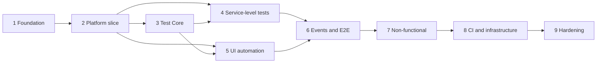

# Implementation Plan

## Completion status

All nine milestones are implemented as version `0.1.0`. The authoritative delivered inventory,
verification evidence, capability-dependent checks, and operator commands are maintained in
[PROJECT_STATUS.md](PROJECT_STATUS.md); requirement-to-test traceability is maintained in
[docs/COVERAGE_MATRIX.md](docs/COVERAGE_MATRIX.md).

## Delivery principles

UrbanFlow is delivered as independently verifiable milestones. Each milestone must compile, run its applicable tests, update documentation and `PROJECT_STATUS.md`, and end in one cohesive Conventional Commit. Test-count targets are reached only with behavior-checking tests; empty, disabled, or duplicate cases do not count.

## Milestone 1 — Architecture and repository foundation

**Scope:** workspace/toolchain analysis, Maven reactor, dependency and plugin catalog, system and test architecture, domain boundaries, shipment state machine, risk analysis, test strategy, quality gates, traceability model, governance, wrapper, roadmap, and status reporting.

**Exit criteria:**

- JDK 25 and Maven 3.9.16 are verified.
- `./mvnw clean verify` succeeds for the complete reactor.
- No unresolved Maven models or pre-release dependencies exist.
- Required Phase 1 documents and diagrams are internally consistent.
- Repository is initialized on `main` and the milestone is committed.

## Milestone 2 — Demo platform vertical slice

**Scope:** Spring Boot service foundations, shared HTTP/event conventions, PostgreSQL/Flyway, Redis, Kafka, OpenAPI, identity authentication, shipment aggregate and transition policy, tracking timeline, routing assignment, notification request, warehouse/hub model, and minimum responsive application shells.

**Implementation slices:**

1. Shared error envelope, correlation/trace filters, health endpoints, structured logging.
2. Identity registration/login/refresh/logout/password reset and RBAC.
3. Shipment create/read/cancel/change-address with idempotency and optimistic locking.
4. Transactional outbox and Kafka event publication.
5. Tracking projection and Redis cache invalidation.
6. Courier assignment, hub/warehouse operations, notifications, audit records, flags.
7. Customer, courier, and operations flows with stable `data-testid` contracts.

**Exit criteria:** service unit tests pass; migrations validate against a clean PostgreSQL container; API specification validation passes; minimal UI smoke journeys pass; Kafka and Redis health behavior is verified.

## Milestone 3 — Test Core and test data

**Scope:** immutable configuration, secret resolution, thread-confined driver lifecycle, browser options, local/remote providers, API specifications, response validation, PostgreSQL/Kafka/Redis clients, retry classification, polling, context lifecycles, evidence attachments, schema validation, JUnit extensions/annotations/listeners, deterministic builders/factories, masking, and cleanup.

**Exit criteria:** framework unit tests prove concurrency isolation, cleanup, evidence behavior, retry restrictions, masking, and configuration precedence; no global WebDriver or shared mutable test state exists.

## Milestone 4 — API, component, database, integration, and contract coverage

**Targets:** 100 API, 25 component, 20 database, 25 integration, and 20 contract tests.

**Exit criteria:** all tests verify implemented behavior; provider verification covers five requested relationships; local Pact Broker works through Docker; schemas and OpenAPI conformance pass; Testcontainers suites start from clean state and clean up their own data.

## Milestone 5 — Selenium UI platform and coverage

**Scope:** Page and Component Objects, fluent business actions, explicit/custom waits, local and Grid browser factories, Selenium Manager, Chrome/Firefox/optional Edge, screenshots/page source/console/network/video evidence, parallel execution, parameterized data, responsive testing, and at least 60 meaningful UI tests.

**Exit criteria:** headless Chrome smoke and regression pass; Firefox smoke passes locally or on Grid; no PageFactory, implicit wait, fixed sleep, or avoidable XPath is present.

## Milestone 6 — Events and end-to-end assurance

**Targets:** 30 Kafka/event tests and 20 end-to-end scenarios covering ordering, idempotency, retry/DLT, restart, schema versions, eventual consistency, unique data, and UI/API/Kafka/PostgreSQL agreement.

**Exit criteria:** Awaitility-based checks pass without fixed sleeps; trace IDs connect all evidence for a failed flow; automatic cleanup is proven.

## Milestone 7 — Accessibility, visual, performance, and security

**Targets:** 15 accessibility tests, 15 visual tests, 10 k6 scenarios, and 20 safe security tests.

**Exit criteria:** WCAG 2.2 AA gate blocks critical violations; visual baselines support desktop/tablet/mobile and light/dark modes; k6 thresholds are enforced; ZAP baseline and Dependency-Check produce reports; tests remain confined to the local demo environment.

## Milestone 8 — Delivery infrastructure and observability

**Scope:** Dockerfiles, five Compose profiles, Selenium Grid, Pact Broker, Kafka UI, PostgreSQL, Redis, Kafka, OpenTelemetry Collector, Prometheus, Grafana, 15 GitHub Actions workflows, Kubernetes resources, Helm chart, autoscaling nodes, execution Jobs/CronJobs, and Allure result storage/publishing.

**Exit criteria:** Compose config validates; workflow YAML parses; containers expose health checks; kind or minikube deployment renders and becomes ready; dashboards import successfully; CI artifacts and quality gates are exercised.

## Milestone 9 — Final hardening and release readiness

**Scope:** full documentation pass, links, coverage matrix, generated Allure example, dependency/security review, duplication and forbidden-pattern scans, full clean environment rehearsal, semantic release metadata, and final status.

**Required verification:**

```bash
./mvnw clean verify
./mvnw clean verify -Dgroups=smoke
./mvnw clean verify -Dgroups=api
./mvnw clean verify -Dgroups=ui -Dbrowser=chrome -Dheadless=true
./mvnw clean verify -Dgroups=integration
docker compose --profile full config --quiet
```

Additional validation covers workflow YAML, README links, credentials, unfinished-work markers, placeholder implementations, fixed-duration sleeps, shared static state, test independence, Allure generation, Helm lint/template, and a clean clone rehearsal.

## Dependency graph and sequencing



## Test-count acceptance

Counts come from discovered, enabled, behavior-checking tests in JUnit XML and k6 scenario manifests. Parameterized cases count only when they represent distinct risk partitions. Retries never increase counts. Quarantined tests remain visible but do not satisfy blocking-suite targets.
