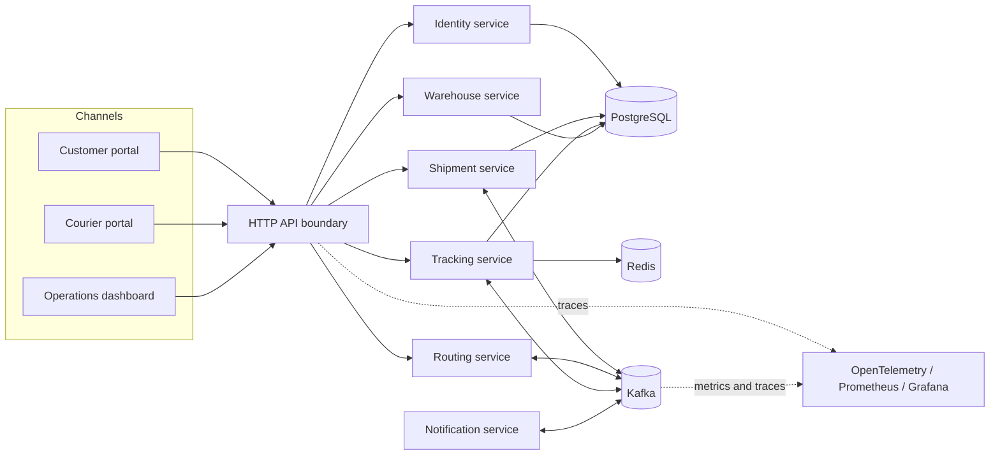
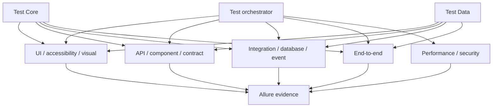
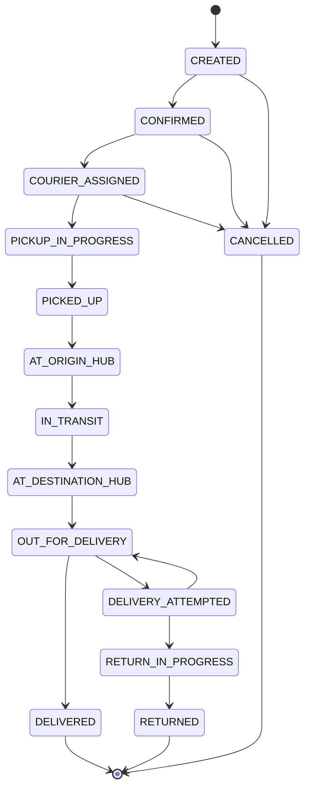
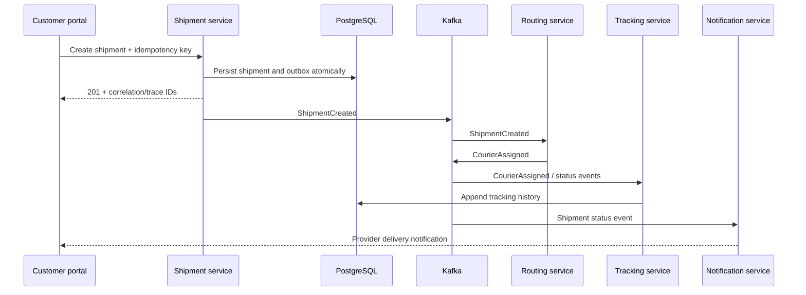

# UrbanFlow Quality Engineering Platform

UrbanFlow is a production-style quality engineering monorepo for a distributed courier and logistics platform. It combines realistic customer, courier, and operations applications with independent services and a reusable automation platform spanning UI, API, contracts, components, integrations, events, databases, end-to-end flows, accessibility, visual regression, performance, and security.

> **Delivery status:** All nine implementation phases are complete. Every fixed suite target is met,
> application and framework gates pass locally, and environment-dependent Docker/Kubernetes checks
> are implemented with explicit capability reporting. Exact evidence and limitations are recorded in
> [PROJECT_STATUS.md](PROJECT_STATUS.md).

## Business domain

The platform models customer registration, shipment creation, courier assignment, hub processing, route execution, live tracking, delivery proof, notifications, incidents, audit records, and feature flags. UUID identifiers are used throughout. Concurrently modified aggregates use optimistic locking, and shipment transitions are controlled by one authoritative state machine.

## Key capabilities

- Three responsive web applications: customer portal, courier portal, and operations dashboard.
- Six independently deployable services: identity, shipment, tracking, routing, notification, and warehouse.
- PostgreSQL persistence, Kafka domain events, and Redis tracking-timeline caching.
- Thread-safe Java test framework with isolated browser, API, data, evidence, and cleanup lifecycles.
- Local, Docker Compose, Selenium Grid, Kubernetes, and Helm execution models.
- Allure reporting plus OpenTelemetry, Prometheus, and Grafana observability.
- CI quality gates for correctness, contracts, accessibility, security, code quality, and reports.

## System architecture



## Test architecture



## Shipment lifecycle



All transitions not shown are rejected. Terminal states cannot transition. The definitive rules and actor permissions live in the shipment domain, not in UI code.

## Event flow



## Technology stack

Java 25 LTS, Maven 3.9.16, Spring Boot 4.1.1 for demo services, Selenium 4.47.0, JUnit 6.1.3, REST Assured 6.0.1, AssertJ, Awaitility, Jackson, Allure, Testcontainers, WireMock, Pact JVM, PostgreSQL, Redis, Kafka, axe-core, k6, OWASP ZAP, OpenTelemetry, Prometheus, Grafana, Docker Compose, Selenium Grid, Kubernetes, Helm, GitHub Actions, JaCoCo, Spotless, Checkstyle, SpotBugs, and OWASP Dependency-Check.

Version choices, verification dates, and source links are maintained in [docs/TECHNOLOGY_DECISIONS.md](docs/TECHNOLOGY_DECISIONS.md).

## Repository structure

```text
apps/                    Customer, courier, and operations web applications
services/                Identity, shipment, tracking, routing, notification, warehouse
test-core/               Reusable thread-safe automation framework
test-data/               Builders, factories, fixtures, anonymization, cleanup
ui-tests/                Selenium user-journey tests
api-tests/               REST Assured black-box API tests
contract-tests/          Pact consumer and provider verification
component-tests/         Service tests with controlled adapters
integration-tests/       Cross-adapter tests with real infrastructure
event-tests/             Kafka schema, ordering, retry, DLT, idempotency tests
database-tests/          PostgreSQL migration, constraint, transaction tests
e2e-tests/               Deployed black-box identity, shipment, and tracking journeys
accessibility-tests/      axe-core WCAG 2.2 AA checks
visual-tests/             Multi-viewport baseline and diff checks
performance-tests/        k6 smoke, load, stress, spike, and soak scenarios
security-tests/           Safe local security regression suite
test-orchestrator/        Suite selection, environment, and unified reporting
observability/            Collector, Prometheus, Grafana, dashboards
infrastructure/           Docker Compose and local platform configuration
kubernetes/               Raw Kubernetes manifests
helm/                     Parameterized test-infrastructure chart
docs/                     Strategy, architecture, operations, and governance
scripts/                  Cross-platform developer and CI entry points
```

## Prerequisites

- JDK 25 LTS (`java -version` must report 25.x).
- Git 2.40 or newer.
- Docker Engine 27+ with Compose v2 for container-backed suites.
- Chrome or Chromium, Firefox, and optionally Edge for local UI execution.
- k6 1.4+ for performance execution.
- kubectl, Helm, and kind or minikube only for Kubernetes workflows.

Maven does not need to be installed; the repository pins Maven 3.9.16 through Maven Wrapper.

## Quick start

```bash
git clone https://github.com/your-org/urbanflow-quality-platform.git
cd urbanflow-quality-platform
./mvnw clean verify
```

Windows PowerShell:

```powershell
git clone https://github.com/your-org/urbanflow-quality-platform.git
Set-Location urbanflow-quality-platform
.\mvnw.cmd clean verify
```

A successful build compiles all 27 reactor projects and runs every locally applicable test. Suites
that require Docker or a deployed stack report explicit skips when that capability is unavailable;
they never substitute simulated passes.

## Local execution

Use focused module commands during development:

```bash
./mvnw clean verify
./mvnw -Pquality clean verify
./mvnw -pl :api-tests -am -Dgroups=api clean test
./mvnw -pl :ui-tests -am -Dgroups=ui -Dbrowser=chrome clean test
./mvnw -pl :event-tests -am -Dgroups=event clean test
./mvnw -pl :accessibility-tests -am -Dgroups=accessibility clean test
./mvnw -pl :visual-tests -am -Dgroups=visual clean test
./mvnw -pl :security-tests -Dgroups=security clean test
```

On Windows, use `mvnw.cmd` instead of `mvnw`. The typed wrapper
`.\scripts\run-suite.ps1 -Suite api -Execute` is convenient when you want unified Allure metadata.

## Docker and deployed E2E execution

Copy `.env.example` to `.env`, fill the blank secret fields, then:

```powershell
.\mvnw.cmd -DskipTests package
docker compose -f infrastructure/compose.yml --profile minimal up -d --build --wait
.\mvnw.cmd -pl :e2e-tests -am -Dgroups=e2e -De2e.enabled=true test
docker compose -f infrastructure/compose.yml --profile minimal down
```

Profiles are `minimal`, `integration`, `grid`, `observability`, and `full`; their contents and ports
are documented in [infrastructure/README.md](infrastructure/README.md).

For Grid, start the application and browser profiles together and give remote browser nodes
network-resolvable application origins:

```powershell
docker compose -f infrastructure/compose.yml --profile minimal --profile grid up -d --build --wait
.\mvnw.cmd -pl :ui-tests -am -Dgroups=ui -Dremote.url=http://localhost:4444 `
  -Dcustomer.url=http://customer-portal:3001 -Dcourier.url=http://courier-portal:3002 `
  -Doperations.url=http://operations-dashboard:3003 test
```

## Test suites and taxonomy

JUnit tags are `smoke`, `regression`, `ui`, `api`, `contract`, `component`, `integration`, `event`, `database`, `e2e`, `accessibility`, `visual`, `performance`, `security`, and `quarantine`. The suite-to-pipeline rules and retry policy are defined in [docs/TEST_STRATEGY.md](docs/TEST_STRATEGY.md) and [docs/FLAKY_TEST_POLICY.md](docs/FLAKY_TEST_POLICY.md).

## Configuration

Configuration resolution follows this precedence: JVM system property, environment variable, environment profile file, safe default. Secrets are resolved from environment or a configured secret provider and are never committed. Logs and Allure attachments mask passwords, tokens, authorization headers, email local parts, phone numbers, and delivery-proof metadata.

## Reports and observability

All Java suites emit JUnit XML and Allure results. Failed UI flows attach a screenshot, page source, browser logs, and available network/video evidence. API and event failures attach masked request/response or event envelopes. Correlation and trace IDs are carried through HTTP, Kafka, logs, and Allure to support a single-flow investigation.

CI publishes merged Allure Pages. Locally, generate and open a module report without a global CLI:

```powershell
npx --yes allure-commandline@2.34.1 generate `
  ui-tests/target/allure-results --clean --output target/allure-report
npx --yes allure-commandline@2.34.1 open target/allure-report
```

The `observability` Compose profile provisions Collector, Prometheus at `9090`, Grafana at `3000`,
eight alerts, and the UrbanFlow quality dashboard.

## CI/CD

```mermaid
flowchart LR
    PR[Pull request] --> STATIC[Compile + style + static analysis]
    STATIC --> FAST[Unit + component + smoke]
    FAST --> CONTRACT[Contract compatibility]
    CONTRACT --> GATES[Security + accessibility gates]
    GATES --> MERGE[Merge eligible]
    MERGE --> NIGHTLY[Sharded nightly regression]
    NIGHTLY --> REPORT[Allure Pages + trend metrics]
    REPORT --> RELEASE[Versioned release]
```



Fifteen workflow entry points plus one private reusable workflow live in `.github/workflows`. Their
triggers, branch gates, sharding, evidence, and retry rules are specified in
[docs/QUALITY_GATES.md](docs/QUALITY_GATES.md) and [docs/CI_CD.md](docs/CI_CD.md).

## Troubleshooting

Start with [docs/TROUBLESHOOTING.md](docs/TROUBLESHOOTING.md). The build intentionally requires Java
25; run `.\scripts\check-prerequisites.ps1` to distinguish required and optional tooling.

## Roadmap

All nine delivery phases are complete. Their dependencies, exit criteria, test targets, and final
verification commands remain available in [IMPLEMENTATION_PLAN.md](IMPLEMENTATION_PLAN.md); the
current release evidence is in [PROJECT_STATUS.md](PROJECT_STATUS.md).

## Contributing

Read [docs/CONTRIBUTING.md](docs/CONTRIBUTING.md) before opening a change. Conventional Commits, small reviewable changes, independent tests, deterministic data, and evidence-backed quality gates are required.

## License

This project is licensed under the [MIT License](LICENSE).
